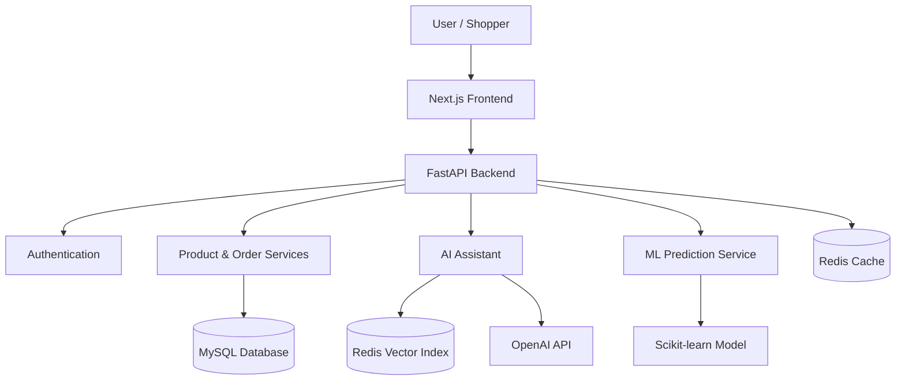
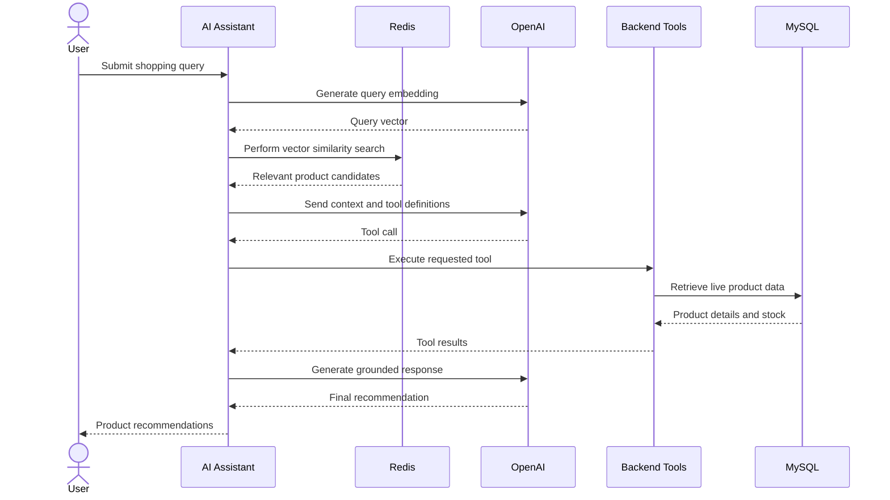
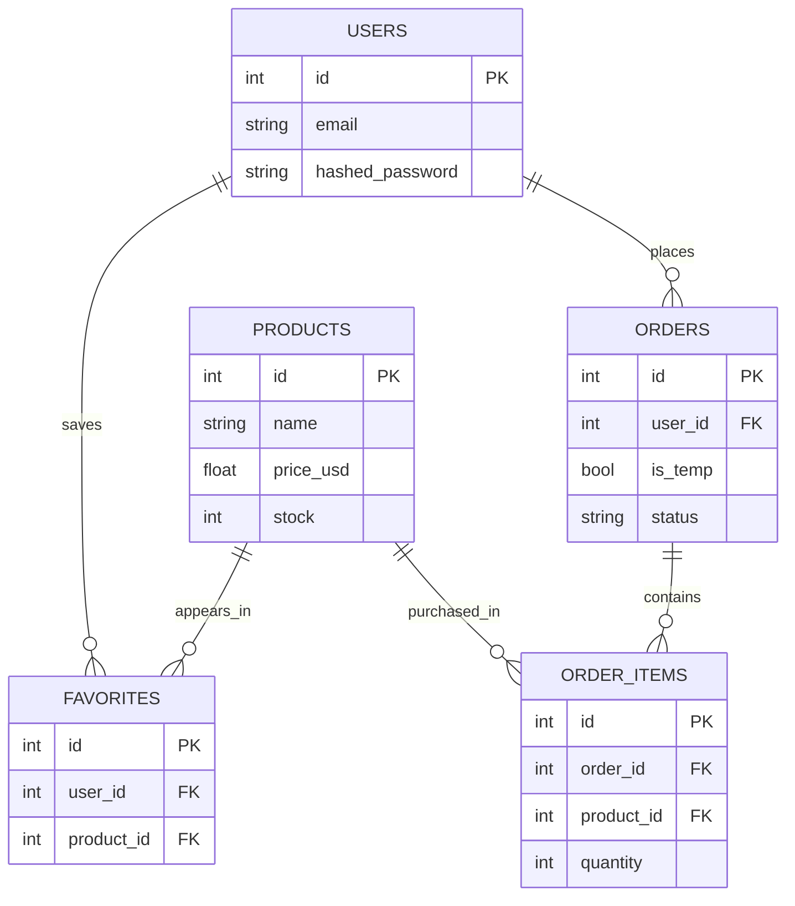

# CartIQ — AI-Powered Intelligent Shopping Platform

<p align="center">
  <strong>A Full-Stack E-Commerce Platform Powered by Generative AI, Retrieval-Augmented Generation, and Machine Learning.</strong>
</p>

<p align="center">
  An intelligent electronics shopping experience combining modern web technologies, real-time inventory management, AI-driven product discovery, and predictive customer analytics.
</p>

<p align="center">
  
  
  
  
  
  
  
  
</p>

---

## 📌 Overview

**CartIQ** is an AI-powered e-commerce application designed to make online shopping more intelligent, personalised, and interactive.

The platform combines a full-stack electronics shopping experience with an AI shopping assistant that understands product information, retrieves relevant inventory data, and interacts with backend services to provide context-aware recommendations.

Beyond traditional e-commerce functionality, the system incorporates a Retrieval-Augmented Generation (RAG) pipeline and a Machine Learning-based customer churn prediction module.

The application demonstrates how modern web development, AI integration, vector search, and predictive analytics can work together in a single software platform.

## ✨ Key Highlights

| Component | Description |
|---|---|
| 🛍️ Product Catalog | 151 seeded electronics products |
| 🤖 AI Assistant | RAG-based conversational shopping assistant |
| 🔍 Vector Search | Redis vector similarity search |
| 🧰 AI Tool Calling | Six integrated assistant tools |
| 📈 Churn Prediction | Machine Learning-based customer analytics |
| 🧪 Automated Testing | 100 reported automated tests |
| ⚡ Deployment | Docker Compose-based application setup |

## 🚀 Features

### 1. Intelligent E-Commerce Store

- Browse a catalog of electronics products.
- Search products using multiple keywords.
- Apply price and stock range filters.
- View detailed product information.
- Add products to favourites.
- Manage shopping carts.
- Complete purchases with transactional stock management.
- Register, log in, log out, and delete accounts.
- Secure authentication using bcrypt password hashing and JWT.

### 2. AI-Powered Shopping Assistant

The integrated AI assistant helps users discover products through natural language conversations.

**Core capabilities:**

- Retrieval-Augmented Generation (RAG).
- Semantic product search using vector embeddings.
- Context-aware product recommendations.
- Live inventory and stock verification.
- Similar-product recommendations.
- Product detail retrieval.
- Add products to favourites through AI tool calls.
- Alternative product suggestions when items are unavailable.

The assistant uses product information retrieved from the database to ground its recommendations rather than relying exclusively on the language model's general knowledge.

### 3. Machine Learning-Based Customer Churn Prediction

CartIQ also includes a customer churn prediction module built using Scikit-learn.

It analyses customer behaviour using RFM-style features:

- Recency
- Frequency
- Monetary spending
- Favourite activity

The model uses Logistic Regression and Random Forest for experimentation and comparison.

**Model capabilities:**

- Customer churn probability estimation.
- Explainable predictions.
- Feature-weight analysis.
- Customer behaviour insights.
- REST API-based prediction.

Reported model performance:

| Metric | Result |
|---|---:|
| ROC-AUC | Approximately 0.852 |
| Training approach | Synthetic customer data |
| Primary model | Logistic Regression |
| Comparison model | Random Forest |

The training dataset includes synthetic class overlap and label noise to make the prediction task more realistic.

---

## 🏗️ System Architecture

CartIQ follows a layered architecture that separates the frontend, backend services, data storage, and AI components.



### Technology Architecture

**Frontend**
- Next.js 16
- React 19
- Tailwind CSS
- React Context API

**Backend**
- Python 3.11
- FastAPI
- SQLAlchemy
- Alembic
- Pydantic
- MVC-inspired layered architecture

**Database and Caching**
- MySQL 8
- Redis
- Redis Vector Search

**Artificial Intelligence**
- OpenAI API
- Retrieval-Augmented Generation
- Text Embeddings
- Native Function / Tool Calling

**Machine Learning**
- Scikit-learn
- Logistic Regression
- Random Forest
- Customer Churn Analysis

**Infrastructure**
- Docker
- Docker Compose
- Pytest

---

## 🤖 AI Architecture: Retrieval-Augmented Generation

The AI assistant is one of the central components of the platform.

It combines semantic retrieval with an agentic tool-calling workflow to provide product recommendations based on the available inventory.

### How it works

1. The user submits a natural-language shopping query.
2. The query is converted into a vector embedding.
3. Redis performs similarity search against indexed product embeddings.
4. Relevant product candidates are retrieved.
5. The assistant receives product context and available tool definitions.
6. It can call backend tools to retrieve product details and check live stock.
7. The final response is generated using retrieved product information.

### AI Workflow



### RAG Implementation Details

- Uses OpenAI `text-embedding-3-small`.
- Product embeddings are stored as 1536-dimensional FLOAT32 vectors.
- Redis uses cosine similarity for vector retrieval.
- A FLAT KNN index is used for similarity search.
- Product availability is verified using live database information.
- AI tool execution is implemented through a custom tool-calling loop.

The implementation does not depend on LangChain for its core RAG and agent workflow.

---

## 📊 Machine Learning: Customer Churn Prediction

The platform includes an ML module for identifying customers who may stop using the shopping application.

### Prediction workflow

1. Collect customer activity information.
2. Extract RFM-based behavioural features.
3. Prepare and preprocess the dataset.
4. Train classification models.
5. Evaluate model performance.
6. Generate churn probability and interpretable prediction reasons.

### Models

| Algorithm | Purpose |
|---|---|
| Logistic Regression | Primary interpretable classifier |
| Random Forest | Comparative classification model |

### API Endpoint

```http
GET /ml/churn/{user_id}
```

The endpoint returns an estimated churn probability and supporting information derived from the model.

**Note:** The reported training results are based on synthetic customer data and should not be interpreted as verified real-world business performance.

---

## 🗄️ Database Design

The application uses MySQL as its primary relational database.

### Main Entities

- Users
- Products
- Orders
- Order Items
- Favorites

### Entity Relationship Diagram



### Order Management

The application maintains a temporary order as the user's active shopping cart.

- A user can have only one temporary cart.
- Adding products updates the active cart.
- Removing all items can automatically delete the empty cart.
- Checkout converts the temporary order into a completed order.
- Transactional database operations protect stock consistency.
- Row-level locking helps prevent concurrent purchases from overselling available inventory.

---

## ⚙️ Installation and Setup

### Prerequisites

Install the following:

- Git
- Docker Desktop
- Visual Studio Code
- OpenAI API key (for AI functionality)

### 1. Clone the repository

```bash
git clone https://github.com/YOUR_USERNAME/CartIQ.git

cd CartIQ
```

### 2. Configure environment variables

Copy the example environment file:

**Windows PowerShell:**

```powershell
Copy-Item .env.example .env
```

**Linux / macOS:**

```bash
cp .env.example .env
```

Open `.env` and configure the required environment variables, including your OpenAI API key.

Never commit `.env` or expose API credentials publicly.

### 3. Start the application

```bash
docker compose up --build
```

Docker Compose starts the configured services, including the frontend, backend, MySQL, and Redis.

### 4. Access the application

| Service | URL |
|---|---|
| Shopping Website | http://localhost:3000 |
| Backend API | http://localhost:8000 |
| Swagger API Docs | http://localhost:8000/docs |

### 5. Initialise AI and ML components

Build the product embedding index:

```bash
docker compose exec backend python scripts/embed_products.py
```

Generate synthetic customer data:

```bash
docker compose exec backend python scripts/seed_synthetic_users.py
```

The AI assistant requires a valid OpenAI API key. Without one, the shopping application can continue operating, but AI chat functionality will be unavailable.

---

## 🧪 Testing

The backend includes automated tests covering important application components.

### Run backend tests

```bash
cd backend

pytest
```

### Run integration tests

```bash
pytest -m integration
```

### Build the frontend

```bash
cd frontend

npm install

npm run build
```

### Reported Testing Coverage

The original project documentation reports 100 automated tests:

- 98 unit tests.
- 2 integration tests.
- Authentication testing.
- Product catalogue and search testing.
- Favorites and order management testing.
- AI tools and agent workflow testing.
- Machine Learning pipeline testing.

The reported integration tests require a running Redis service.

---

## 📁 Project Structure

```text
CartIQ/
│
├── backend/
│   ├── app/
│   │   ├── ai/
│   │   ├── ml/
│   │   ├── controllers/
│   │   ├── services/
│   │   ├── repositories/
│   │   └── models/
│   ├── tests/
│   ├── alembic/
│   └── Dockerfile
│
├── frontend/
│   ├── src/
│   │   ├── app/
│   │   ├── components/
│   │   └── context/
│   └── Dockerfile
│
├── data/
│   └── products.seed.json
│
├── docs/
│
├── ml_training/
│
├── scripts/
│   ├── embed_products.py
│   ├── seed_synthetic_users.py
│   └── seed_products.py
│
├── docker-compose.yml
├── .env.example
├── .gitignore
└── README.md
```

---

## 🔮 Future Scope

Potential areas for further development include:

- Personalised product recommendation systems.
- Hybrid collaborative and content-based filtering.
- Advanced customer behaviour analytics.
- Product price prediction.
- Explainable AI recommendations.
- Improved semantic search and retrieval evaluation.
- AI-powered conversational product discovery.
- Cloud deployment and scalability improvements.

These are potential extensions, not claims about currently implemented features.

---

## 🧰 Complete Technology Stack

| Category | Technologies |
|---|---|
| Frontend | Next.js, React, Tailwind CSS |
| Backend | Python, FastAPI |
| Database | MySQL |
| Caching | Redis |
| AI | OpenAI API, RAG, Tool Calling |
| Vector Search | Redis Vector Search |
| ML | Scikit-learn |
| ORM | SQLAlchemy |
| Migrations | Alembic |
| Authentication | JWT, bcrypt |
| Testing | Pytest |
| Deployment | Docker, Docker Compose |


<p align="center">
  <strong>CartIQ — Making Online Shopping Smarter with AI.</strong>
</p>
